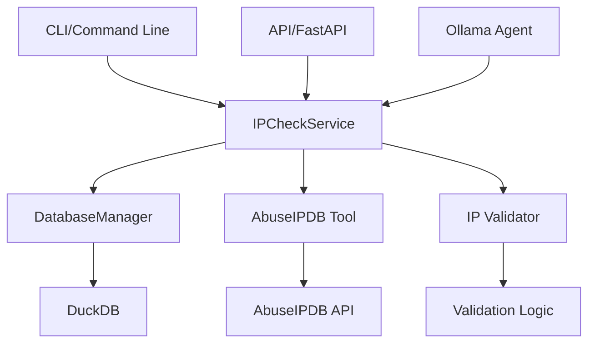

# Plan Détaillé d'Implémentation des Corrections du Code Review

## 1. Problème de Duplication de Code

### Problème
La logique de vérification d'IP existe à la fois dans `src/main.py` et `src/models/ollama_agent.py`.

### Solution
Créer un service centralisé `IPCheckService` qui encapsule la logique de vérification d'IP.

#### Étapes :
1. Créer `src/services/ip_check_service.py`
2. Déplacer la logique commune de vérification d'IP dans ce service
3. Mettre à jour `src/main.py` et `src/models/ollama_agent.py` pour utiliser ce service
4. Assurer la compatibilité avec les interfaces existantes

## 2. Problème de Connexion à la Base de Données

### Problème
Dans `src/main.py`, la connexion à la base de données est gérée à la fois dans la fonction `check_ip_reputation` et dans la fonction `main`, ce qui peut entraîner des problèmes de gestion des ressources.

### Solution
Uniformiser l'utilisation de la classe `DatabaseManager` dans `src/database/db_manager.py` partout où possible.

#### Étapes :
1. Mettre à jour `src/main.py` pour utiliser `DatabaseManager`
2. Mettre à jour `src/models/ollama_agent.py` si nécessaire
3. Mettre à jour `src/api.py` pour utiliser `DatabaseManager`
4. S'assurer que toutes les connexions sont correctement gérées avec des context managers

## 3. Problème de Gestion des Erreurs dans l'API

### Problème
L'API AbuseIPDB dans `src/api.py` n'utilise pas la classe `RateLimitExceededError` définie dans `src/tools/abuseipdb_tool.py`.

### Solution
Mettre à jour l'API pour utiliser la classe `RateLimitExceededError` du module partagé.

#### Étapes :
1. Mettre à jour `src/api.py` pour importer et utiliser `RateLimitExceededError` de `src/tools/abuseipdb_tool.py`
2. Remplacer l'implémentation locale de `RateLimitExceededError` dans `src/api.py`
3. S'assurer que les exceptions sont correctement propagées et gérées

## 4. Problème de Hardcoding d'URL

### Problème
Les URLs des services de réputation sont codées en dur dans les prompts.

### Solution
Déplacer les URLs et autres paramètres dans un fichier de configuration ou des variables d'environnement.

#### Étapes :
1. Créer un fichier de configuration ou un module de paramètres
2. Remplacer les URLs codées en dur dans les prompts par des variables
3. Mettre à jour les modules pour utiliser ces variables de configuration
4. Mettre à jour le fichier `.env` si nécessaire

## 5. Améliorations Requises

### Configuration Externe
1. Créer `config/settings.py` ou `config/config.yaml` pour gérer les paramètres
2. Déplacer toutes les constantes et URLs vers ce fichier/module
3. Mettre à jour tous les modules pour utiliser cette configuration

### Tests
1. Créer un répertoire `tests/`
2. Ajouter des tests unitaires pour les modules critiques
3. Ajouter des tests d'intégration

### Type Hints
1. Améliorer les annotations de type dans les fonctions critiques
2. Utiliser des types génériques appropriés
3. Vérifier la cohérence des annotations de type

## 6. Structure du Nouveau Service

Le nouveau service `IPCheckService` devra inclure :

```python
class IPCheckService:
    def __init__(self, db_manager: DatabaseManager, model_name: str = "ollama_chat/qwen3:latest"):
        # Initialisation du service
        
    def check_ip_reputation(self, ip_address: str, use_cache: bool = True) -> Tuple[Optional[str], str]:
        # Méthode principale pour vérifier la réputation d'une IP
        
    def check_ip_reputation_with_abuseipdb(self, ip_address: str) -> Optional[Dict[str, Any]]:
        # Méthode pour vérifier via l'API AbuseIPDB
        
    def run_check(self, ip_address: str) -> Tuple[Optional[str], float, str]:
        # Méthode pour exécuter un check complet avec timing
```

## 7. Migration des Modules

Après la création du service centralisé :
1. Mettre à jour `src/main.py` pour utiliser `IPCheckService`
2. Mettre à jour `src/cli/cli.py` pour utiliser `IPCheckService`
3. Simplifier `src/models/ollama_agent.py` pour qu'il délègue au service centralisé

## 8. Gestion des Erreurs Standardisée

Créer un module `src/exceptions.py` pour gérer toutes les exceptions personnalisées :

```python
class IPReputationError(Exception):
    """Base exception for IP reputation checker"""
    pass

class RateLimitExceededError(IPReputationError):
    """Exception raised when API rate limit is exceeded"""
    pass

class InvalidIPAddressError(IPReputationError):
    """Exception raised when an IP address is invalid"""
    pass
```

## 9. Mise à Jour de l'Architecture

Diagramme de l'architecture modifiée :



## 10. Plan de Migration

1. Étape 1 : Créer le service centralisé
2. Étape 2 : Mettre à jour la gestion des erreurs
3. Étape 3 : Externaliser les configurations
4. Étape 4 : Mettre à jour les modules existants
5. Étape 5 : Ajouter les tests
6. Étape 6 : Vérifier la compatibilité et tester
7. Étape 7 : Mettre à jour la documentation

Ce plan permet de résoudre tous les problèmes identifiés dans le code review de manière structurée et progressive.